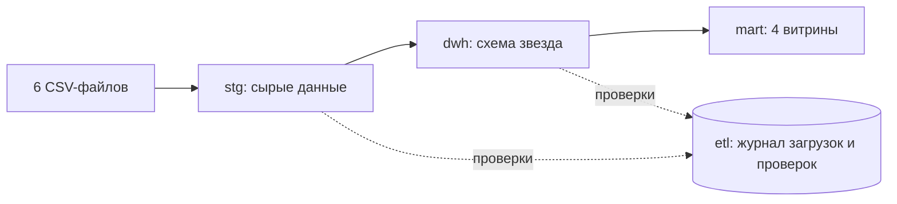
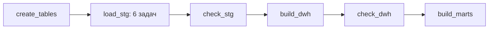
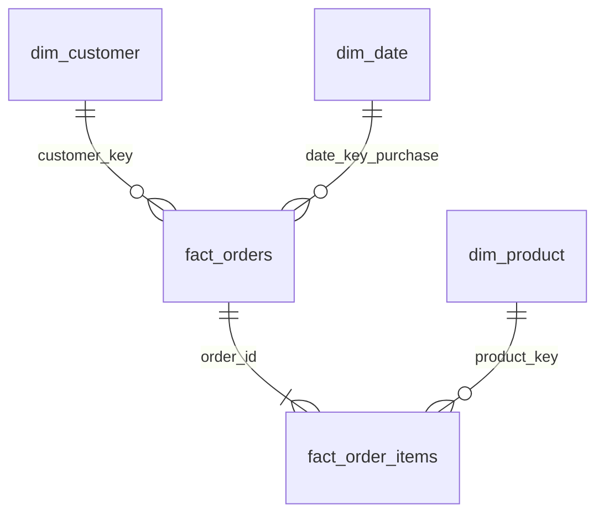

# Olist ETL: Airflow + PostgreSQL + DWH

Учебный ETL-проект по открытому датасету [Olist Brazilian E-Commerce](https://www.kaggle.com/datasets/olistbr/brazilian-ecommerce). CSV-файлы загружаются в PostgreSQL, проходят проверки качества, превращаются в хранилище со схемой «звезда» и витрины для аналитики. Оркестрация в Apache Airflow, запуск через Docker Compose.

## Цель проекта

Пройти полный путь данных, как в корпоративном хранилище: сырой слой, очистка, модель «звезда», проверки, витрины, журнал загрузок. Отдельная цель: показать, что результат можно проверить (сверка слоёв по количеству строк и суммам) и что запуск можно повторять без дубликатов.

## Архитектура



### Граф DAG `olist_etl`




| Задача    | Что делает                                                                                                                                                                                                                      |
| --------------- | ---------------------------------------------------------------------------------------------------------------------------------------------------------------------------------------------------------------------------------------- |
| `create_tables` | создаёт схемы`stg`,`dwh`,`mart`,`etl`и таблицы stg и журнала                                                                                                                                                 |
| `load_stg`      | 6 параллельных по графу задач:`TRUNCATE`и`COPY`каждого CSV, запись числа строк в`etl.load_log`; каждая таблица грузится в отдельной транзакции |
| `check_stg`     | 12 проверок сырых данных                                                                                                                                                                                              |
| `build_dwh`     | очистка и сборка измерений и фактов в одной транзакции                                                                                                                                     |
| `check_dwh`     | 6 проверок: сверка слоёв по числу строк и суммам                                                                                                                                                   |
| `build_marts`   | пересоздание 4 витрин                                                                                                                                                                                                  |

Если проверка уровня `error` не пройдена, задача падает, а следующие этапы не запускаются. Проверки уровня `warn` пишутся в журнал и в лог, но пайплайн не останавливают.

## Модель данных (слой dwh)




| Таблица     | Зерно (одна строка =)     | Особенности                                                                                                                                                                                            |
| ------------------ | ---------------------------------------- | ----------------------------------------------------------------------------------------------------------------------------------------------------------------------------------------------------------------- |
| `dim_date`         | один календарный день | генерируется через`generate_series`, ключ в формате ГГГГММДД                                                                                                                 |
| `dim_customer`     | один`customer_id`                    | суррогатный ключ; город приводится к виду`Sao Paulo`, штат к`SP`                                                                                                          |
| `dim_product`      | один товар                      | суррогатный ключ; категория на английском из справочника, при отсутствии перевода берётся португальская или`unknown` |
| `fact_orders`      | один заказ                      | дни доставки, признак опоздания, число позиций, суммы позиций, доставки и платежей, признак нелогичных дат                |
| `fact_order_items` | одна позиция заказа     | ключ`(order_id, order_item_id)`, внешние ключи на заказ и товар                                                                                                                      |

Позиции и платежи агрегируются по заказу до присоединения к `fact_orders`. Если соединить их напрямую, строки размножаются и суммы удваиваются.

## Витрины (слой mart)


| Витрина           | Что показывает                                                                                                                             | Приёмы SQL                     |
| ------------------------ | ------------------------------------------------------------------------------------------------------------------------------------------------------- | ------------------------------------ |
| `monthly_revenue`        | выручка и число заказов по месяцам, нарастающий итог, прирост к предыдущему месяцу | CTE,`SUM() OVER`,`LAG`               |
| `top_categories_monthly` | топ-3 категорий по выручке в каждом месяце                                                                            | CTE,`RANK() OVER (PARTITION BY ...)` |
| `delivery_by_state`      | доля опозданий и среднее время доставки по штатам                                                             | `JOIN`,`COUNT(*) FILTER`             |
| `customer_rfm`           | давность последней покупки, число заказов и сумма по клиентам, оценки R и M от 1 до 5    | `NTILE`, подзапрос          |


## Проверки качества данных

Результат каждой проверки при каждом запуске сохраняется в `etl.dq_results` (слой, название, число плохих строк, серьёзность, статус).

* **stg (12):** таблицы не пусты, `order_id` и `customer_id` не NULL и уникальны, дата покупки задана, цена больше 0, платёж не отрицателен, у заказа есть клиент (`warn`).
* **dwh (6):** число строк в фактах совпадает со stg, сумма цен позиций и сумма платежей совпадают со stg, заказы без клиента (`warn`), заказы с нелогичными датами (`warn`).

```sql
SELECT layer, check_name, bad_rows, status
FROM etl.dq_results
WHERE status <> 'OK'
ORDER BY checked_at DESC;
```

## Результаты запуска


| Таблица         | Строк |
| ---------------------- | ---------- |
| stg.orders             | 99441      |
| stg.order\_items       | 112650     |
| stg.order\_payments    | 103886     |
| stg.customers          | 99441      |
| dwh.fact\_orders       | 99441      |
| dwh.fact\_order\_items | 112650     |

Нелогичных дат найдено: 18.

## Оптимизация запросов

В `sql/explain_demo.sql` сравнивается выполнение одного запроса с индексом `idx_fact_orders_customer` и без него.


| Вариант        | План                                                 | Время выполнения |
| --------------------- | -------------------------------------------------------- | ------------------------------- |
| с индексом   | Index Scan using idx_fact_orders_customer on fact_orders | 0.698 мс                     |
| без индекса | Seq Scan on fact_orders                                  | 46.103 мс                     |

Индексы создаются в `sql/02_dwh.sql` по полям, которые используются в соединениях и фильтрах: `customer_key`, `date_key_purchase`, `status`, `product_key`.

## Как запустить

Нужны Docker Desktop и около 4 ГБ свободной памяти.

1. Скачайте с Kaggle датасет Olist и положите в папку `data/` шесть файлов: `olist_orders_dataset.csv`, `olist_order_items_dataset.csv`, `olist_order_payments_dataset.csv`, `olist_customers_dataset.csv`, `olist_products_dataset.csv`, `product_category_name_translation.csv`.
2. Запустите контейнеры:
   ```bash
   docker compose up -d
   ```
3. Получите пароль пользователя `admin`:
   ```bash
   docker compose exec airflow cat /opt/airflow/standalone_admin_password.txt
   ```
4. Откройте http://localhost:8080, войдите как `admin` и запустите DAG `olist_etl` кнопкой ▶.
5. Результат смотрите в базе (порт 5433, пользователь `dwh`, пароль `dwh`, база `warehouse`):
   ```bash
   docker compose exec warehouse psql -U dwh -d warehouse
   ```

Остановить: `docker compose stop`. Удалить всё вместе с данными: `docker compose down -v`.

### Дашборд (необязательно)

```bash
docker compose --profile bi up -d
```

Откройте http://localhost:3000, пройдите первичную настройку Metabase и добавьте базу PostgreSQL: хост `warehouse`, порт `5432`, база `warehouse`, пользователь `dwh`, пароль `dwh`. Строить дашборды удобно по таблицам схемы `mart`.


## Стек

Apache Airflow 2.10, PostgreSQL 16, Python 3.12, SQL, Docker Compose, Metabase (необязательно).

## Ограничения

* Запуск ручной (`schedule=None`), потому что данные статичные.
* Загрузка полная: таблицы очищаются и заполняются заново. Инкрементальной загрузки и истории изменений измерений (SCD) нет.
* Метаданные Airflow хранятся в SQLite, исполнитель последовательный. Для учебного проекта этого достаточно.
* Таблицы с отзывами, продавцами и геолокацией из датасета не загружаются.
* Пароли в `docker-compose.yml` учебные.
